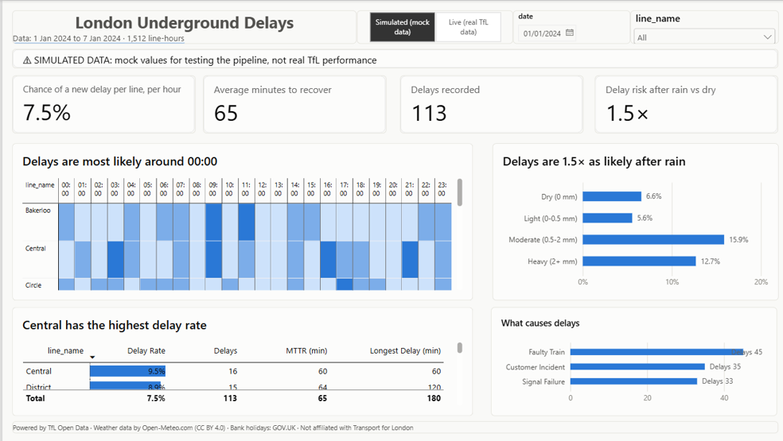
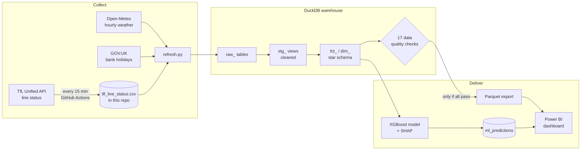
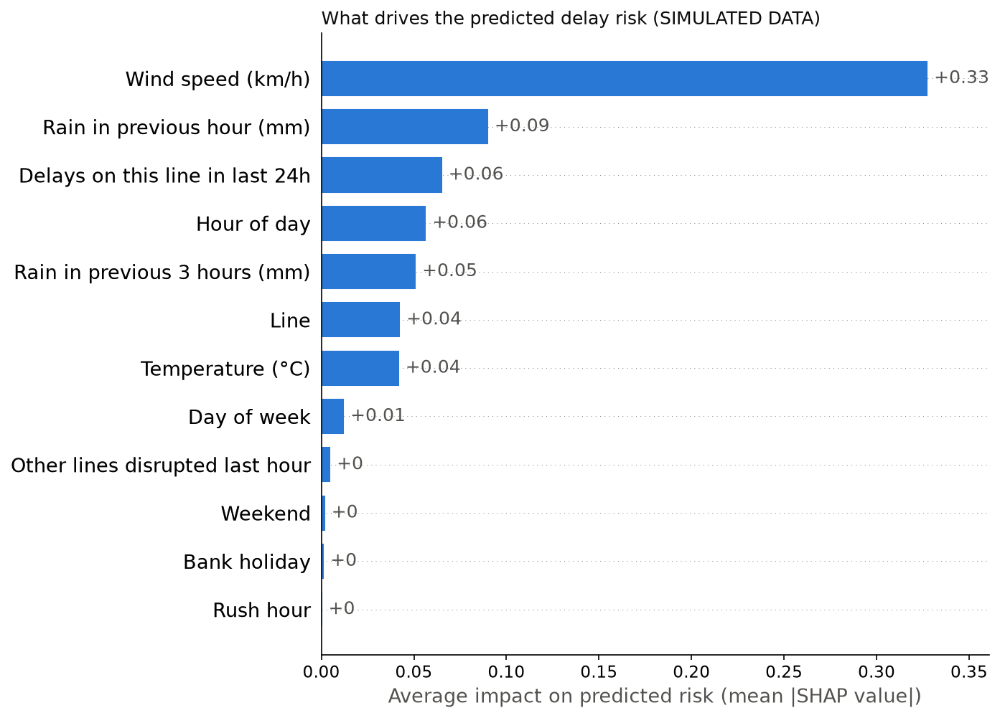
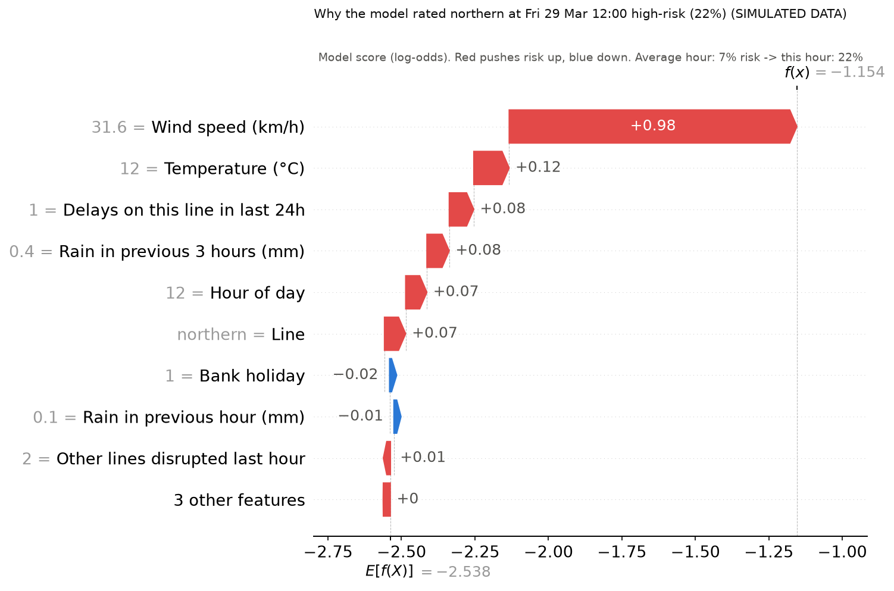

# London Underground Delay Analytics

**An end-to-end data project: live Tube status collected every 15 minutes, a SQL warehouse, a Power BI dashboard, and a machine-learning model that predicts delays an hour ahead and explains why.**

[](https://github.com/AJC-mdx/tfl-delay-analytics/actions/workflows/collect_tfl_status.yml)

> **Project status:** the full pipeline is built and validated. TfL does not publish historical line status, so this project **collects its own** (since October 2026). Until a few months of real data have built up, the dashboard and model results shown here use **clearly labelled simulated data** (see [Results](#results)).



---

## Why it matters

When a Tube line is delayed, the impact depends on **when** it happens, **how long** it lasts and **what caused it**. An operator who can see:

- **where and when delays cluster** (line × hour of day),
- **how quickly service recovers** (Mean Time To Recovery),
- **how much bad weather raises the risk**, and
- **which hours are high-risk before they start**

can plan staffing, maintenance windows and customer communication ahead of time instead of reacting. This project builds that view from public data.

## What I built



| Area | What's in it |
|---|---|
| **Data engineering** | A Python collector runs on **GitHub Actions** every 15 minutes (triggered by cron-job.org, because GitHub's own scheduler skipped ~90% of runs) and commits each snapshot to the repo. One command (`python refresh.py`) pulls new data, downloads weather and bank holidays, rebuilds the warehouse, runs the quality checks and exports for Power BI. |
| **SQL (DuckDB)** | Layered warehouse: `raw_` → `stg_` → `fct_`/`dim_`. Window functions, a **gaps-and-islands** query for delay durations, an **ASOF join**, reusable macros, and **data-quality checks** that block the Power BI export if anything fails. |
| **Power BI** | Star schema (2 fact tables, 4 dimensions), DAX measures (Delay Rate, **Mean Time To Recovery**, **Weather Delay Risk**), dynamic titles, a colour-blind-checked theme, and a second page for the model. |
| **Machine learning** | XGBoost predicting *"will a new delay start on this line in the next hour?"*, with leakage-safe features, a time-based train/test split, baselines, ROC-AUC / PR-AUC, and **SHAP** explanations for every prediction. |

## Key decisions (and why)

- **Delay duration as a gaps-and-islands problem.** Status arrives as 15-minute snapshots. `LAG`/`LEAD` flag where a disruption starts, and a running `SUM() OVER` numbers each unbroken run. Gaps in the data end a delay rather than stretching it ([`sql/04_fct_delay_episodes.sql`](sql/04_fct_delay_episodes.sql)).
- **Overnight closures are not delays.** "Service Closed" is classified separately through a lookup table, and a quality check enforces it. Otherwise every night would count as a multi-hour delay.
- **No data leakage.** Every model feature is known *at the start* of the hour: rain in the *previous* hour, never during it. The line's starting status comes from an ASOF join to the last snapshot *before* the hour, and a quality check fails if any feature uses data from inside the hour ([`sql/11_fct_ml_features.sql`](sql/11_fct_ml_features.sql)).
- **The right question for the model.** Hours where the line is *already* delayed are excluded. Otherwise the model just learns "already delayed, so no new delay" and looks skilful while predicting nothing useful.
- **Honest evaluation.** Train on earlier hours, test on later ones (never a random split). Results are compared with two baselines and with the best score possible on the data. Accuracy is not used, since ~93% of hours have no new delay.
- **Validate against a known answer first.** The simulated data has one rule built in (rain > 0.5 mm in the previous hour, or wind > 25 km/h, triples the delay chance). The weather analysis and the model both had to rediscover that rule before any real data is trusted.

## Results

### On simulated data (validation)

These numbers prove the pipeline finds a real pattern when one exists. **They are not findings about the real Tube.**

| Check | Built-in truth | What the pipeline found |
|---|---|---|
| Delay chance in bad vs normal weather (SQL) | 15% vs 5% | 15.4% vs 5.1% |
| Model ranking skill, ROC-AUC (test set) | 0.62 = best possible | **0.61** XGBoost · 0.58 logistic regression · 0.50 baseline |
| Top drivers (SHAP) | wind, rain in previous hour | wind, rain in previous hour |
| Actual delay rate in hours rated High vs Normal risk | — | **16.2% vs 5.5% (2.9×)** |

<p>
  
  
</p>

### On real data

Collection of real TfL status runs continuously ([see the latest snapshots](data/tfl_live_status.csv)). The first day of reliable data (20 Oct 2026) already captured 17 real delays, from 30-minute minor delays to part suspensions lasting most of the day. Once enough data is collected, the same dashboard and model run on it with one switch (`--source live`).

## Run it yourself

Requires Python 3.12+ and (for the dashboard) Power BI Desktop.

```bash
git clone https://github.com/AJC-mdx/tfl-delay-analytics.git
cd tfl-delay-analytics
pip install -r requirements.txt

python refresh.py        # pull data, build the warehouse, run checks, export for Power BI
python train_model.py    # train + explain the model (simulated data); add --source live for real data
```

Then follow [`powerbi/POWERBI_GUIDE.md`](powerbi/POWERBI_GUIDE.md) to build the report.

## Project structure

```
├── .github/workflows/collect_tfl_status.yml   # cloud collector, every 15 min
├── collect_tfl_status.py     # one snapshot of every Tube line's status
├── refresh.py                # one command: pull data → warehouse → checks → Power BI export
├── get_weather.py            # Open-Meteo weather for all dates we have
├── get_bank_holidays.py      # UK bank holidays (GOV.UK)
├── generate_tfl_history.py   # simulated history with a known rule (for validation)
├── load_database.py          # builds tfl.duckdb, runs checks, exports Parquet
├── train_model.py            # XGBoost + SHAP + predictions back into the database
├── sql/                      # all warehouse logic, run in order (00_ … 11_) + checks.sql
├── data/                     # collected and downloaded data; reference/ lookups
├── ml/mock/                  # model metrics, saved model, SHAP charts
└── powerbi/                  # theme, build guide, screenshots
```

## Data sources

- **Line status:** [Transport for London Unified API](https://api.tfl.gov.uk/). Powered by TfL Open Data.
- **Weather:** [Open-Meteo](https://open-meteo.com/) (CC BY 4.0).
- **Bank holidays:** [GOV.UK](https://www.gov.uk/bank-holidays) (Open Government Licence).
- **Station footfall 2024:** TfL Open Data (loaded and cleaned; not yet used in the dashboard).

Not affiliated with or endorsed by Transport for London.

## Limitations and next steps

- **Real data is still accumulating.** Results will be updated once a few months are collected; rare events (storms, strikes) need longer.
- **15-minute resolution.** Delay start and end times are accurate to the snapshot interval.
- **Weather is a single point in central London.** Lines that run far out (e.g. Metropolitan) may see different conditions.
- **Next:** weight delays by passengers affected using station footfall; group TfL's free-text delay reasons into categories; a weekly scheduled retrain.

---

*Built by Ahmed Choudhry · [github.com/AJC-mdx](https://github.com/AJC-mdx)*
